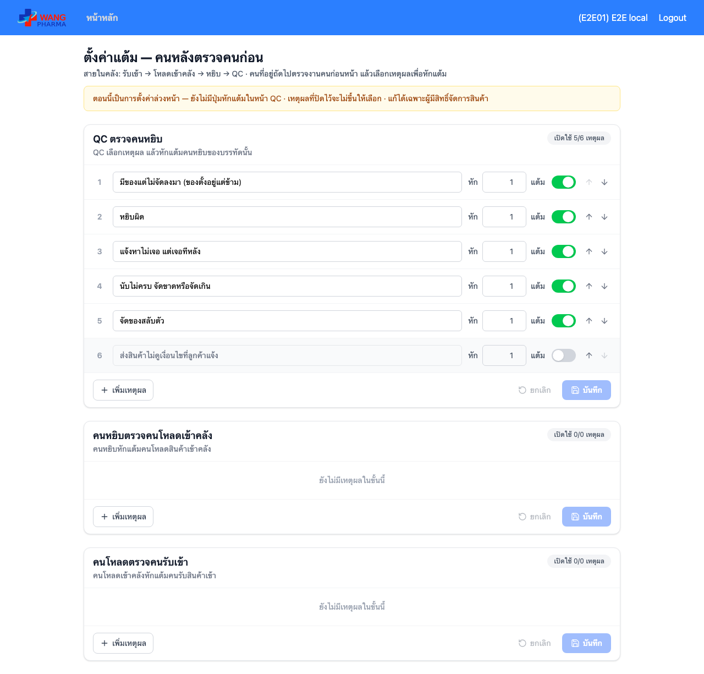

# E2E — ตั้งค่าแต้ม คนหลังตรวจคนก่อน (/chain-audit-settings)

| | |
|---|---|
| Environment | **local** — frontend (Vite) + **backend จริง** + MySQL ทดสอบบนเครื่อง (`op_rt_e2e`) ที่รัน migration `ChainAuditReason1792200000000` แล้ว · login ผ่าน auth จำลองที่เซ็น JWT ด้วย secret ของ env ทดสอบ (E2E01, manage_product = Yes) |
| Commit frontend | `d8e18ea` (`feat/chain-audit-settings`) |
| Commit backend | `8d4c867` (Wang-OrderPickingService-NestJS `feat/chain-audit-reasons`) |
| เวลา | 2026-10-24 10:55 (เวลาไทย) |
| สคริปต์ | `e2e/chain-audit-settings.e2e.mjs` |
| ผล | **12/12 ผ่าน** |
| สถานะ | ผ่านก่อน merge เท่านั้น — หลัง deploy รัน `E2E_ENV=prod` (อ่านอย่างเดียว ไม่กดบันทึก) |

## สิ่งที่ตรวจ

| # | ตรวจ | ผล |
|---|---|---|
| 1 | เมนู admin "ตั้งค่าแต้ม (คนหลังตรวจคนก่อน)" ขึ้นในหน้าแรก | ผ่าน |
| 2 | แสดงครบ 3 ขั้น (QC → หยิบ, หยิบ → โหลดเข้าคลัง, โหลด → รับเข้า) | ผ่าน |
| 3 | เหตุผล QC → หยิบ ตรงกับ API ตามลำดับ | ผ่าน |
| 4–5 | ค่าเริ่มต้นจาก migration: 6 ข้อตามลำดับ ข้อละ 1 แต้ม ข้อ 6 ปิด | ผ่าน |
| 6 | แก้แล้วขึ้น "ยังไม่ได้บันทึก" | ผ่าน |
| 7–8 | บันทึก: ข้อ 2 = 3 แต้ม, ปิดข้อ 1, เพิ่มเหตุผลใหม่ 2 แต้ม (code CUSTOM_…) + คนแก้ = E2E01 | ผ่าน |
| 9 | รีโหลดแล้วค่ายังอยู่ | ผ่าน |
| 10 | ข้อความซ้ำถูกเตือนก่อนส่ง | ผ่าน |
| 11 | คืนค่าเดิม + ปิดเหตุผลที่เพิ่ม | ผ่าน |
| 12 | ไม่มีสิทธิ์ (manage_product ≠ Yes): ช่องล็อก ไม่มีปุ่มบันทึก | ผ่าน |

ตรวจในฐานหลังรัน: ประทับคนแก้เฉพาะแถวที่เปลี่ยน (ข้อ 1, 2 และข้อที่เพิ่ม) แถวอื่นยังว่าง · ลบเหตุผลทดสอบด้วย `DELETE FROM chain_audit_reason WHERE label LIKE 'E2E local %'` แล้ว

Migration ทดสอบแยกกับฐานเปล่า: up → 6 แถว · down → ลบตาราง · up ซ้ำสองรอบ → ยังเป็น 6 แถว (INSERT IGNORE)

รันคู่กับชุด `rt-floor-claim` บน stack เดียวกัน (backend รวมทั้งสอง branch) → 8/8 ผ่าน

หมายเหตุ: เวลา "แก้ล่าสุด" บนเครื่องนี้ขึ้นเร็วไป 7 ชม. เพราะ MySQL ใน devstack ตั้ง timezone ระบบเป็นเวลาไทย — แบบเดียวกับ updated_at ของตารางตั้งค่าอื่นที่มีอยู่

