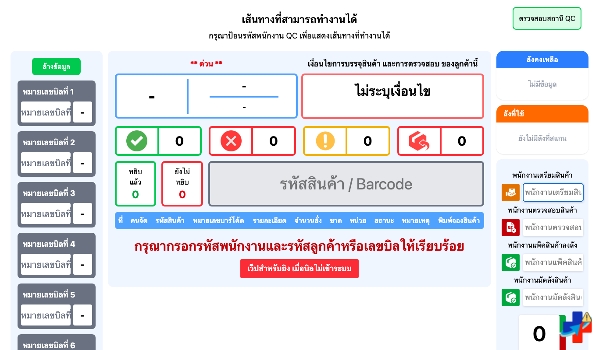
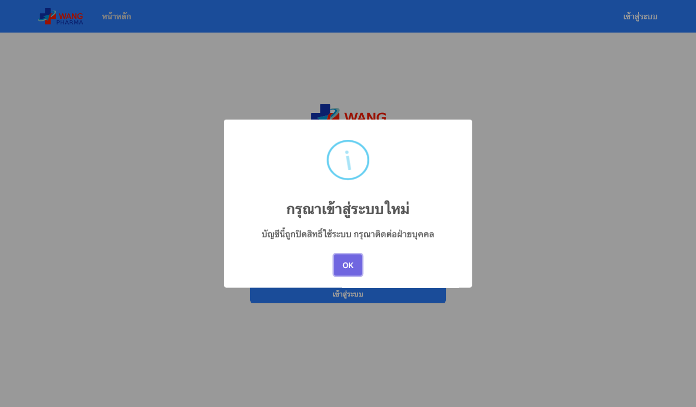
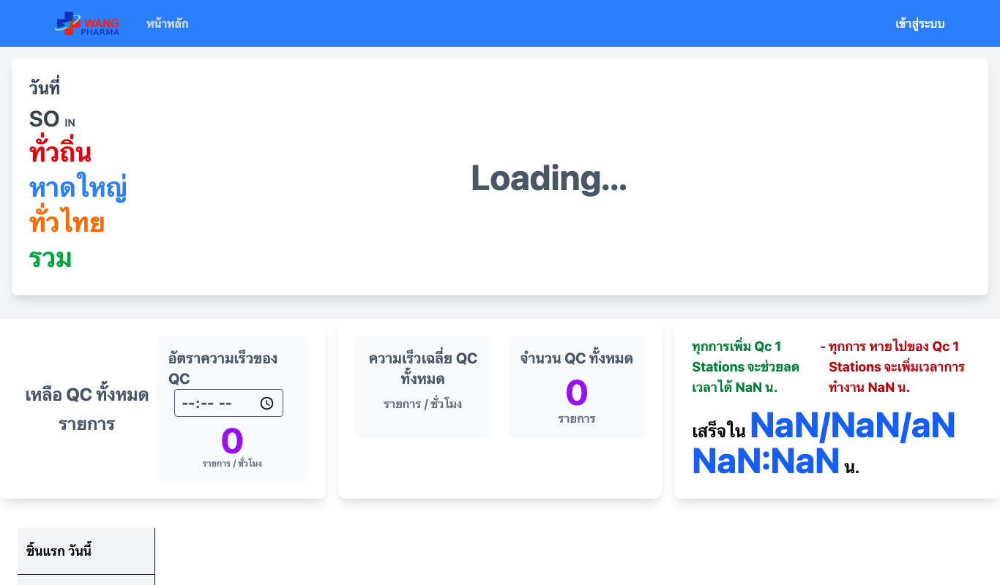

# E2E (browser) — หน้า QC ส่ง token ตอนต่อ socket และ logout เองเมื่อถูกตัดสิทธิ์

- **environment: local** (MySQL + Kafka ใน docker · auth + order-picking + vite บนเครื่อง · ไม่แตะ production)
- commit ที่ทดสอบ: หน้าเว็บ `f097d4c` · order-picking `678b578` (#288, `WS_AUTH_ON_CONNECT=enforce`) · auth `54fb56a` (#27)
- Playwright 1.58 Chromium headless · สคริปต์ `scripts/e2e-qc-socket-revoked.mjs`
- ผล local นับแค่ "ผ่านก่อน merge" ต้องรันซ้ำกับ deployed code หลัง deploy

## ผล — ผ่าน 8/8
```
  ✓ login ที่ auth ได้ token — HTTP 201
  ✓ หน้า QC เปิด socket /socket/qc และต่อค้างได้ (enforce ยอมรับ token ที่ส่งไป) — ["/","/socket/reload-page/","/socket/qc/"]
  ✓ บัญชี SERVICE สั่งตัดสิทธิ์สำเร็จ — HTTP 200
  ✓ Kafka ถึง order-picking — 254 ms
  ✓ หน้า QC ขึ้น "กรุณาเข้าสู่ระบบใหม่" เอง (ไม่ต้องกดอะไร)
  ✓ token ใน sessionStorage ถูกลบ (logout แล้ว)
  ✓ socket QC ถูกปิด
  ✓ จอ KPI ไม่ login ยังต่อ /socket/kpi ได้ — ["/","/socket/kpi/","/socket/reload-page/"]
[cleanup] เหลือค้าง auth 0 (ต้องเป็น 0)
```

## รูป
| หน้า QC ต่อ socket ได้ | ถูกตัดสิทธิ์แล้ว logout เอง | จอ KPI (ไม่ login) |
|---|---|---|
|  |  |  |

## ไม่ได้ทดสอบ
- หน้า OrderList / ProductList / ReportEmployee / TaskApproval / Worklog (เพิ่มแค่ watchRevoked · ใช้ helper ตัวเดียวกับหน้า QC)
- มือถือ (หน้า QC ใช้บนเดสก์ท็อป)
