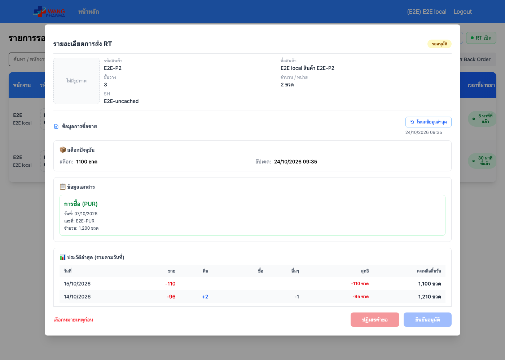

# E2E — RT approval (หน้า /rt-approval)

| | |
|---|---|
| Environment | **local** (UI จริงจาก Vite + API จำลองในสคริปต์ ไม่แตะระบบใด) |
| Commit ที่ทดสอบ | `45dab69` (branch `fix/rt-approval-history-note`) |
| เวลา | 2026-10-24 09:46 (เวลาไทย) |
| สคริปต์ | `e2e/rt-approval.e2e.mjs` |
| ผล | **19/19 ผ่าน** |
| สถานะ | ผ่านก่อน merge เท่านั้น — ต้องรันซ้ำแบบ `E2E_ENV=prod` หลัง deploy |

## วิธีรัน

```bash
VITE_API_URL_ORDER=http://e2e-mock.invalid VITE_API_URL_AUTH=http://e2e-mock.invalid npx vite --port 5176
E2E_ENV=local FRONTEND_URL=http://localhost:5176 node e2e/rt-approval.e2e.mjs
```

ข้อมูลจำลองขึ้นต้น `E2E local` ทั้งหมด อยู่ในสคริปต์ ไม่มีอะไรต้องเก็บกวาด

## สิ่งที่ตรวจ

| # | ตรวจ | ผล |
|---|---|---|
| 1 | เปิดรายการ → ข้อมูลการซื้อขายขึ้นเองโดยไม่กดปุ่ม (มีในระบบแล้ว / ยังไม่มี) | ผ่าน ×2 |
| 2 | ยังไม่มีในระบบ: ยิง GET history ก่อน แล้ว POST find ครั้งเดียว ไม่ขึ้นป๊อปอัป | ผ่าน |
| 3 | มีในระบบแล้ว: ไม่ยิง POST find | ผ่าน |
| 4 | ไม่มีข้อความ "Invalid Date" | ผ่าน ×2 |
| 5 | ประวัติเรียงใหม่ → เก่า (มีวันที่ > 12 คือ 13–15 ต.ค.) | ผ่าน ×2 |
| 6 | คงเหลือสิ้นวัน 15/10=1,100 · 14/10=1,210 · 13/10=1,305 · 07/10=1,385 (amount เป็น string) | ผ่าน ×2 |
| 7 | RTIN แยกไปคอลัมน์ "อื่นๆ" ไม่ถูกนับเป็นซื้อ | ผ่าน ×2 |
| 8 | ไม่เลือกหมายเหตุ / เลือก "อื่นๆ" แต่ไม่พิมพ์ → ปุ่มกดไม่ได้ · พิมพ์แล้วกดได้ | ผ่าน (3 ข้อ) |
| 9 | อนุมัติแล้ว PATCH ส่ง note ที่พิมพ์ | ผ่าน |

รันสคริปต์เดียวกันกับโค้ดเดิมใน develop (`b42b549`): ตกตั้งแต่ข้อ 1 (ข้อมูลไม่โหลดเอง)


