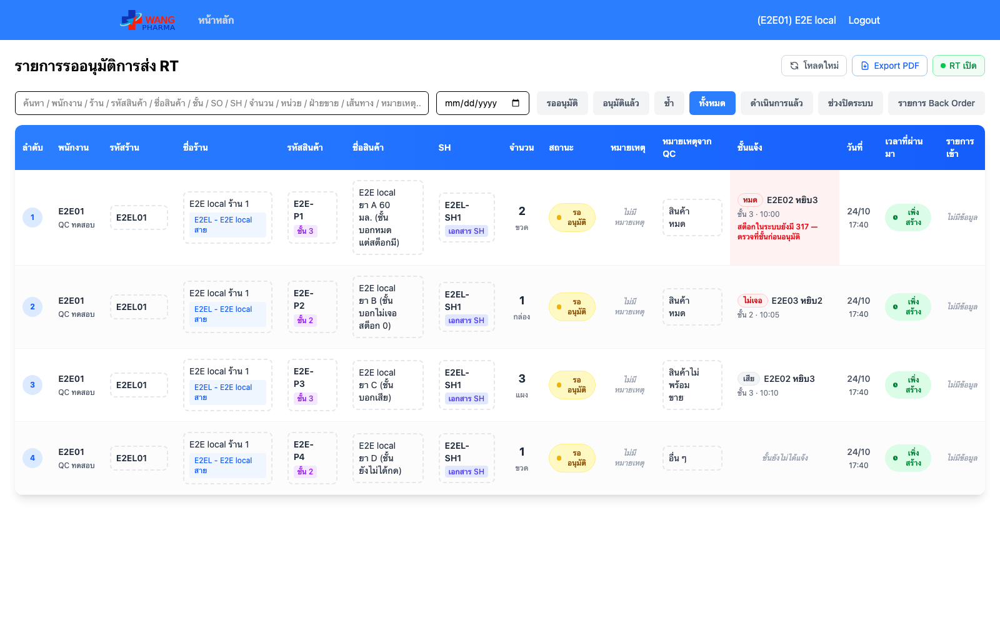
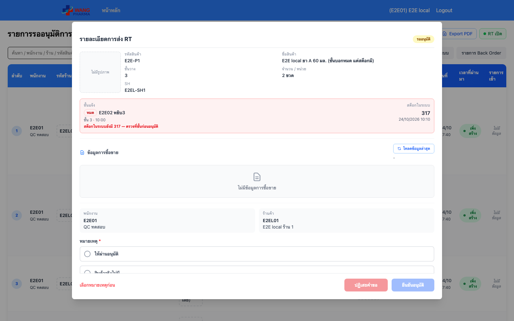

# E2E — RT approval: ชั้นแจ้ง + สต็อกในระบบ

| | |
|---|---|
| Environment | **local** — frontend (Vite) + **backend จริง** จาก branch + MySQL ทดสอบบนเครื่อง (`op_rt_e2e`, ฐานใหม่ synchronize) · login ผ่าน auth จำลองที่เซ็น JWT ด้วย secret ของ env ทดสอบ |
| Commit frontend | `800bec4` (`feat/rt-approval-floor-claim`) |
| Commit backend | `41c1d78` (Wang-OrderPickingService-NestJS `feat/rt-floor-claim`) |
| เวลา | 2026-10-24 10:41 (เวลาไทย) |
| สคริปต์ | `e2e/rt-floor-claim.e2e.mjs` · seed `e2e/rt-floor-claim.seed.sql` |
| ผล | **8/8 ผ่าน** |
| สถานะ | ผ่านก่อน merge เท่านั้น — ต้องรันซ้ำแบบ `E2E_ENV=prod` (อ่านอย่างเดียว) หลัง deploy ทั้งสอง repo |

## ข้อมูลทดสอบ (ขึ้นต้น E2E local / E2E-P / E2EL ทั้งหมด, seed ลบของเดิมก่อนใส่ใหม่)

| บรรทัด | ชั้นแจ้ง | สต็อกในระบบ | ควรเห็น |
|---|---|---|---|
| E2EL-SO1 | หมด โดย E2E02 ชั้น 3 | 317 | เตือน "ตรวจที่ชั้นก่อนอนุมัติ" |
| E2EL-SO2 | ไม่เจอ โดย E2E03 ชั้น 2 | 0 | แสดง ไม่เตือน |
| E2EL-SO3 | เสีย โดย E2E02 | 50 | แสดง ไม่นับว่าไม่มีของ |
| E2EL-SO4 | (ยังไม่มีใครกด) | 12 | "ชั้นยังไม่ได้แจ้ง" |

ฐานใหม่ไม่มี flag `rt-request` → seed ใส่ให้ (prod มีอยู่แล้ว)

## ผล

| # | ตรวจ | ผล |
|---|---|---|
| 1 | API `GET /api/rt-request` ส่ง `floor_claim` + `product.stock` ทุกรายการ | ผ่าน (4) |
| 2 | ตารางมีคอลัมน์ "ชั้นแจ้ง" | ผ่าน |
| 3 | ทุกแถวแสดงคนแจ้ง/สถานะ และเตือนตรงกับ API | ผ่าน (4 แถว) |
| 4–7 | seed SO1–SO4 ตามตารางด้านบน | ผ่าน |
| 8 | หน้าต่างรายละเอียดแสดงแผงชั้นแจ้ง + สต็อกในระบบ + คำเตือน | ผ่าน |

หมายเหตุ: ช่อง "วันที่" ของ `rt_request.created_at` บนเครื่องนี้ขึ้นเร็วไป 7 ชม. เพราะ MySQL ใน devstack ตั้ง timezone ระบบเป็นเวลาไทย (คอลัมน์ TIMESTAMP แปลงตาม session) — เป็นของเดิม ไม่เกี่ยวกับงานนี้ · เวลาที่ชั้นแจ้ง (`so_picking_time`, DATETIME) ถูกต้อง

