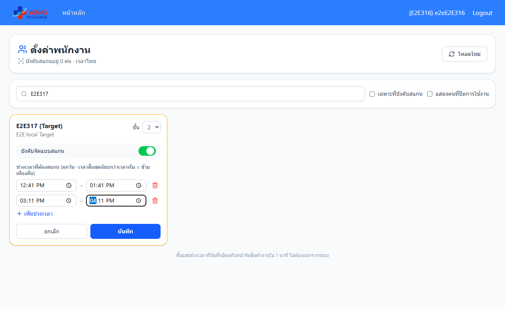
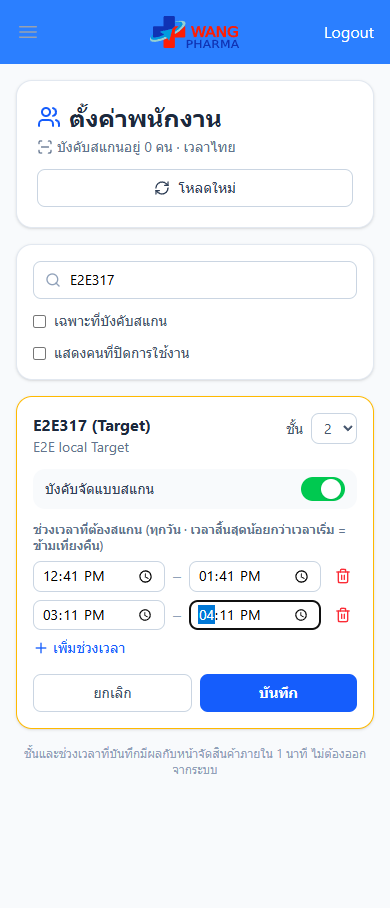
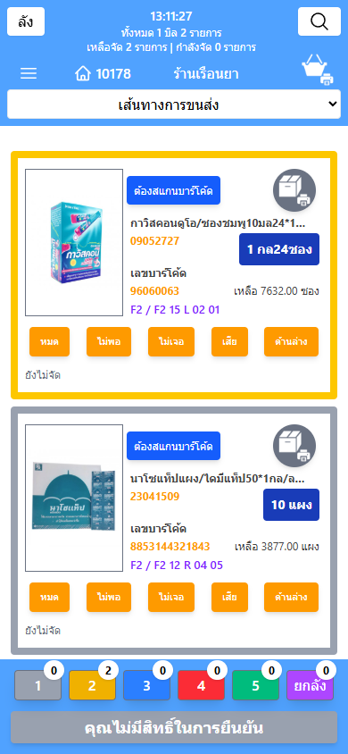
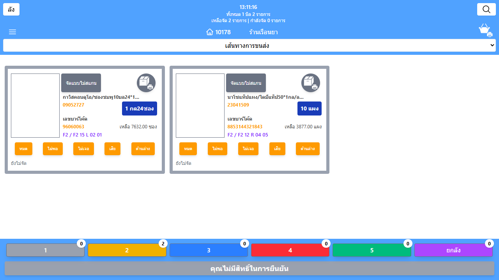

# คู่มือ: ตั้งค่าพนักงาน — บังคับจัดสินค้าแบบสแกน + ชั้นประจำ (OPHMBC-316)

ใช้กำหนดว่าพนักงานคนไหนต้อง **สแกนบาร์โค้ดทุกครั้ง** ตอนจัดสินค้า ในช่วงเวลาไหนของวัน และแก้ **ชั้นประจำ** ของพนักงานได้จากหน้าเดียวกัน

> ถ้าไม่เห็นเมนูนี้: ผู้ดูแลระบบต้องเปิดฟีเจอร์ `employee-scan-setting` ก่อน และบัญชีของคุณต้องมีสิทธิ์ **ผู้จัดการ QC (manage_qc)**

---

## 1. หัวหน้า / ผู้จัดการ QC (สิทธิ์ manage_qc)

### เข้าเมนู
หน้าหลัก → **ตั้งค่าพนักงาน (สแกน/ชั้น)**

### ขั้นตอน
1. พิมพ์รหัส ชื่อ หรือชื่อเล่นพนักงานในช่องค้นหา
2. ที่การ์ดของพนักงาน:
   - **ชั้น** — เลือกชั้นประจำ (มีผลทันทีกับหน้าจัดสินค้า ไม่ต้องให้พนักงานออกจากระบบ)
   - **บังคับจัดแบบสแกน** — กดเปิด (สีเขียว)
   - **เพิ่มช่วงเวลา** — ใส่เวลาเริ่มและเวลาสิ้นสุด ใส่ได้หลายช่วงต่อวัน (สูงสุด 10 ช่วง) ใช้ทุกวัน
     - ถ้าเวลาสิ้นสุดน้อยกว่าเวลาเริ่ม เช่น 22:00 – 02:00 = ข้ามเที่ยงคืน
     - กดไอคอนถังขยะเพื่อลบช่วง
3. กด **บันทึก** (การ์ดที่ยังไม่บันทึกจะมีกรอบสีเหลือง กด **ยกเลิก** เพื่อคืนค่าเดิม)

| Desktop | มือถือ |
|---|---|
|  |  |

### ผลลัพธ์ที่คาดหวัง
- ขึ้น "บันทึกแล้ว"
- หน้าจัดสินค้าของพนักงานคนนั้นเปลี่ยนตามภายใน 1 นาที

### ข้อควรระวัง
- เปิดบังคับสแกนต้องมีช่วงเวลาอย่างน้อย 1 ช่วง ไม่งั้นบันทึกไม่ได้
- นอกช่วงเวลาที่ตั้งไว้ พนักงานจะกลับมาใช้ปุ่ม "จัดแบบไม่สแกน" ได้ตามปกติ
- ติ๊ก **แสดงคนที่ปิดการใช้งาน** ถ้าต้องการเห็นพนักงานที่ถูกปิดสิทธิ์เข้าระบบ

---

## 2. พนักงานจัดสินค้า

ไม่ต้องตั้งค่าอะไร เมื่ออยู่ในช่วงเวลาที่ถูกบังคับสแกน:

- ปุ่ม **"จัดแบบไม่สแกน"** จะหายไป มีป้าย **"ต้องสแกนบาร์โค้ด"** แทน
- กดที่การ์ดสินค้า (การ์ดเป็นสีเหลือง) แล้วยิงบาร์โค้ดสินค้าเพื่อจัด
- ปุ่ม หมด / ไม่พอ / ไม่เจอ / เสีย / ด้านล่าง ใช้ได้ตามปกติ
- ถ้าหัวหน้าเปลี่ยนชั้นให้ ระบบใช้ชั้นใหม่เองภายใน 1 นาที ไม่ต้องออกจากระบบ

| ช่วงบังคับสแกน (มือถือ) | นอกช่วง / ไม่ได้บังคับ |
|---|---|
|  |  |

ถ้าเห็นข้อความ **"ช่วงเวลานี้คุณต้องจัดสินค้าแบบสแกนบาร์โค้ดเท่านั้น"** แปลว่าระบบไม่บันทึกรายการนั้น ให้สแกนบาร์โค้ดใหม่

---

## 3. คนที่ไม่มีสิทธิ์ manage_qc

จะไม่เห็นเมนู ถ้าเข้าลิงก์ตรงจะเห็นข้อความ "ต้องมีสิทธิ์ manage_qc ถึงจะตั้งค่าพนักงานได้"

