# คู่มือ: แผงควบคุมสายการไหล (จัดการ Order)

> ใช้กับ: OPHMBC-322 (หน้าแผงควบคุม) และ OPHMBC-320 (ระงับเพราะลังขาด + คนจัดระหว่างระงับ)
> ภาพในคู่มือถ่ายจากระบบทดสอบ ชื่อร้าน/พนักงานที่ขึ้นต้นด้วย "E2E" เป็นข้อมูลทดสอบ

หน้านี้รวมทุกอย่างที่ตัดสินว่า **"ใครเริ่มจัดร้านไหนได้ ตอนไหน"** ไว้ในหน้าเดียว:
เปิด/ปิดแต่ละสถานี · กติกาเริ่มจัด · ลูกค้าด่วน · การเปิดเส้นทางทีละชุด · การระงับอัตโนมัติ · ลังขั้นต่ำรายชั้น · สวิตช์รายเส้นทาง

**สารบัญ**
1. [ใครใช้หน้านี้ได้ และเข้าทางไหน](#1-ใครใช้หน้านี้ได้-และเข้าทางไหน)
2. [ภาพรวมหน้าจอ](#2-ภาพรวมหน้าจอ)
3. [สำหรับแอดมิน — ตั้งค่าแต่ละส่วน](#3-สำหรับแอดมิน--ตั้งค่าแต่ละส่วน)
4. [สำหรับพนักงานจัดออเดอร์ — เห็นอะไรเมื่อถูกระงับ](#4-สำหรับพนักงานจัดออเดอร์--เห็นอะไรเมื่อถูกระงับ)
5. [สำหรับคนจัดระหว่างระงับ](#5-สำหรับคนจัดระหว่างระงับ)
6. [คำถามที่พบบ่อย](#6-คำถามที่พบบ่อย)
7. [สิ่งที่ยังทำไม่ได้](#7-สิ่งที่ยังทำไม่ได้)

---

## 1. ใครใช้หน้านี้ได้ และเข้าทางไหน

| บทบาท | ใช้หน้านี้ได้ไหม | เกี่ยวข้องยังไง |
|---|---|---|
| **แอดมิน** (สิทธิ์ "จัดการสินค้า" = Yes) | ✅ ตั้งค่าได้ทุกอย่าง | ส่วนที่ 3 |
| **พนักงานจัดออเดอร์** | ❌ | เห็นผลบนหน้าจัดออเดอร์ — ส่วนที่ 4 |
| **คนจัดระหว่างระงับ** (แอดมินเลือกไว้ชั้นละ 1 คน) | ❌ | เริ่มจัดได้แม้ถูกระงับ — ส่วนที่ 5 |

**วิธีเข้า:** หน้าหลัก → หัวข้อ **"เมนูสำหรับผู้ดูแล"** → กด **"แผงควบคุมสายการไหล"**

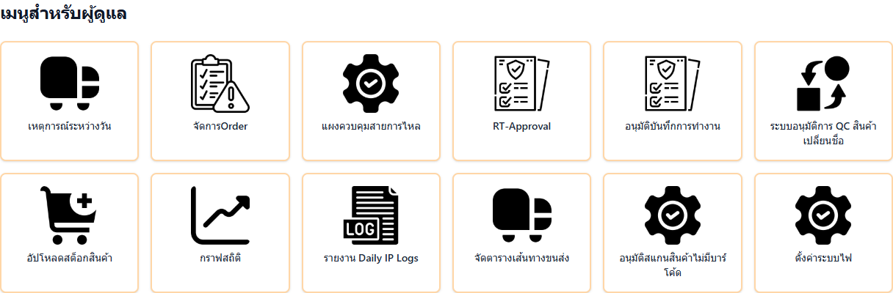

> ⚠️ **ไม่เห็นเมนู?** เมนูนี้จะขึ้นเมื่อเปิดฟีเจอร์ `picking-control-page` แล้วเท่านั้น และต้องเป็นแอดมิน (ดูส่วนที่ 6)
> หน้า **"จัดการOrder"** เดิมยังใช้ได้ตามปกติ ตั้งค่าที่หน้าไหนก็มีผลเหมือนกัน

---

## 2. ภาพรวมหน้าจอ

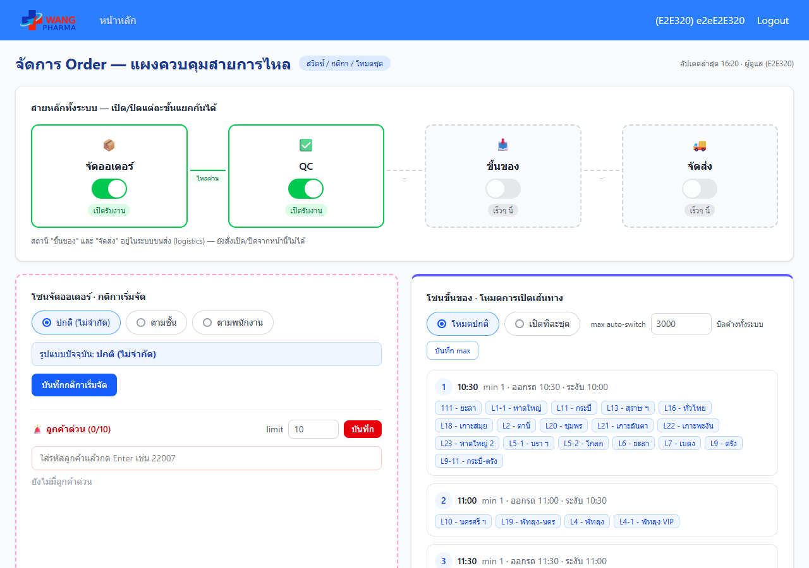

เรียงจากบนลงล่าง:

| # | ส่วน | ใช้ทำอะไร |
|---|---|---|
| ① | แถบเตือนสีเหลือง | ขึ้นเองเมื่อมีสถานีถูกปิด บอกว่าสายถูกตัดตรงไหน |
| ② | **สายหลักทั้งระบบ** | เปิด/ปิดแต่ละสถานี: จัดออเดอร์ → QC → ขึ้นของ → จัดส่ง |
| ③ | **โซนจัดออเดอร์** (กรอบชมพูประ) | กติกาเริ่มจัด + ลูกค้าด่วน |
| ④ | **โซนขึ้นของ** (ขอบบนสีม่วง) | โหมดการเปิดเส้นทาง + ชุดเส้นทาง |
| ⑤ | **ระงับอัตโนมัติ และรายชั้น** | ตารางเวลาระงับรายวัน · ตารางรายชั้น (ลัง + คนจัด) · เส้นทาง Bypass |
| ⑥ | **สายรายเส้นทาง** | เปิด/ปิดทั้งชุด หรือทีละเส้นทาง |

มุมขวาบนบอก **เวลาอัปเดตล่าสุด** — หน้านี้ดึงข้อมูลใหม่เองทุก 1 นาที

**คำอธิบายบนหน้าเว็บ:**
- ทุกส่วนมีปุ่ม **ⓘ วิธีใช้** กดเพื่อกางคำอธิบายของส่วนนั้น (ความหมาย / ผลที่เกิด / ข้อควรระวัง) หรือเปิดสวิตช์ **"แสดงคำอธิบายทั้งหมด"** มุมขวาบนเพื่อกางทุกส่วนพร้อมกัน — เบราว์เซอร์จะจำค่านี้ไว้ครั้งหน้า
- **ทุกช่องกรอก / สวิตช์ / ปุ่ม** มีไอคอน **i** วงกลมสีฟ้าเล็ก ๆ ต่อท้าย กดแล้วขึ้นคำอธิบายของจุดนั้นใต้ช่องทันที กดอีกครั้งเพื่อซ่อน

---

## 3. สำหรับแอดมิน — ตั้งค่าแต่ละส่วน

> ทุกอย่างในหน้านี้ **มีผลกับทุกเครื่องทันที** ที่กดยืนยัน/บันทึก

### 3.1 เปิด/ปิดสถานี (สายหลักทั้งระบบ)

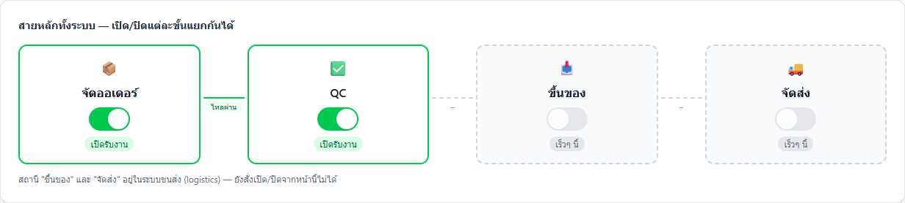

| สถานะของกล่อง | ความหมาย |
|---|---|
| กรอบเขียว + "เปิดรับงาน" | สถานีทำงานปกติ |
| กรอบแดง + "ปิดอยู่" | สถานีถูกปิด |
| กรอบเทาเส้นประ + "เร็วๆ นี้" | ยังสั่งจากหน้านี้ไม่ได้ (ดูส่วนที่ 7) |

เส้นระหว่างกล่อง: **"ไหลผ่าน"** (เขียว) = ทั้งสองฝั่งเปิด · **"ตัดวงจร"** (แดงประ) = ฝั่งใดฝั่งหนึ่งปิด

**ปิดสถานี:**
1. กดสวิตช์ของสถานีที่ต้องการ (เช่น QC)
2. ระบบถามยืนยัน และให้พิมพ์ **ข้อความที่จะแสดงบนจอพนักงาน** (มีข้อความตั้งต้นให้ แก้ได้)
3. กด **ยืนยัน**

**ผลที่เกิด:**
- **ปิดจัดออเดอร์** → หน้าจัดออเดอร์ทุกเครื่องขึ้นหน้าพักระบบพร้อมข้อความที่พิมพ์ เริ่มจัดร้านใหม่ไม่ได้
- **ปิด QC** → หน้า QC ทุกเครื่องขึ้น "ระบบโดนสั่งระงับการใช้งาน" พร้อมหมายเหตุที่พิมพ์ บิลที่จัดเสร็จจะค้างรอ QC
- ด้านบนของหน้านี้ขึ้นแถบเตือน "สายถูกตัดที่ '…'"

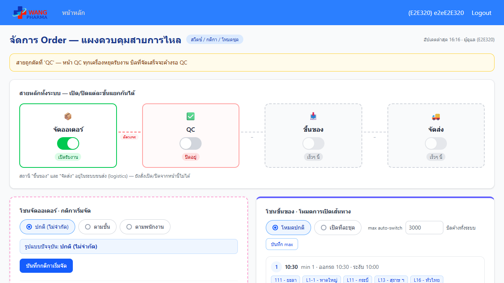

**เปิดกลับ:** กดสวิตช์อีกครั้ง → **ยืนยัน** → แถบเตือนหายไป

> ⚠️ ปิดสถานีแล้ว **พนักงานทั้งคลังหยุดสถานีนั้นทันที** ใช้เมื่อจำเป็นจริง และอย่าลืมเปิดคืน

### 3.2 กติกาเริ่มจัด (โซนจัดออเดอร์)

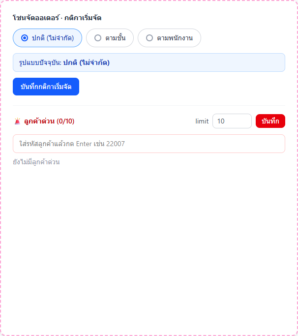

| ตัวเลือก | ใครกดเริ่มจัดได้ |
|---|---|
| **ปกติ (ไม่จำกัด)** | ทุกคน |
| **ตามชั้น** | เฉพาะพนักงานของชั้นที่เลือก และจัดพร้อมกันได้ไม่เกิน N ร้าน |
| **ตามพนักงาน** | เฉพาะพนักงานคนที่เลือก และจัดพร้อมกันได้ไม่เกิน N ร้าน |

ขั้นตอน: เลือกแบบ → (ถ้าไม่ใช่ปกติ) เลือกชั้นหรือพนักงาน + ใส่ **จัดพร้อมกันได้ … ร้าน** → กด **บันทึกกติกาเริ่มจัด**

- กล่องสีฟ้า **"รูปแบบปัจจุบัน"** บอกกติกาที่ใช้อยู่ และจำนวนร้านที่กำลังจัด เช่น `2/4 ร้าน`
- ถ้าเปลี่ยนกติกาตอนที่ยังมีร้านค้างจากกติกาเดิม จะขึ้นกล่องสีส้ม **"⏳ รูปแบบถัดไป…จะเริ่มเมื่อร้านค้าง N ร้านของรูปแบบเดิมจัดเสร็จ"** — ระบบรอให้จัดเสร็จก่อนแล้วเปลี่ยนให้เอง

### 3.3 ลูกค้าด่วน

ร้านในรายการนี้ **ไม่ถูกระงับไม่ว่ากรณีใด** และขึ้นป้ายแดง "ด่วน" บนหน้าจัดออเดอร์

- **เพิ่ม:** พิมพ์รหัสลูกค้าในช่อง แล้วกด **Enter**
- **ยกเลิก:** กด **ยกเลิกด่วน** ท้ายแถว
- **จำนวนสูงสุด:** แก้ช่อง **limit** แล้วกด **บันทึก** — หัวข้อบอกจำนวนปัจจุบัน เช่น `ลูกค้าด่วน (2/10)`

### 3.4 โหมดการเปิดเส้นทาง และชุดเส้นทาง (โซนขึ้นของ)

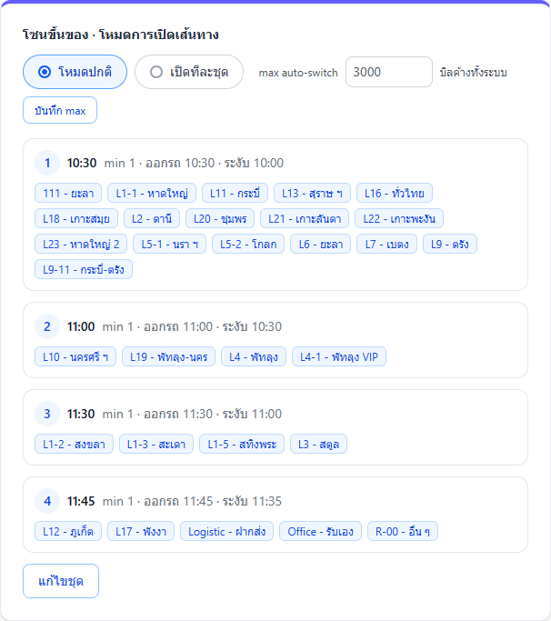

| โหมด | ความหมาย |
|---|---|
| **โหมดปกติ** | เปิด/ปิดเส้นทางเองทีละเส้นหรือทีละชุด (ส่วนที่ 3.7) |
| **เปิดทีละชุด** | ระบบเปิดเฉพาะชุดที่ 1 ก่อน พอของในชุดเหลือถึง **min** จะเปิดชุดถัดไปเอง · เส้นทางที่ไม่อยู่ในชุดไหนจะถูกระงับ |

- **max auto-switch** — ถ้าบิลค้างทั้งระบบถึงตัวเลขนี้ ระบบจะเข้าโหมดเปิดทีละชุดเอง (เว้นว่าง = ไม่ใช้) กด **บันทึก max**
- แต่ละชุดแสดง: ลำดับ · ชื่อ · min · เวลาออกรถ · เวลาเริ่มระงับก่อนออกรถ · เส้นทางในชุด
- บรรทัดสีส้ม **"ยังไม่ได้จัดกลุ่ม…"** บอกเส้นทางที่ยังไม่อยู่ในชุดไหน

**แก้ไขชุด** (ทำได้เฉพาะตอนอยู่ **โหมดปกติ**):
1. กด **แก้ไขชุด**
2. แก้ชื่อ / min เหลือ / เวลาออกรถ / ระงับก่อนออกรถ (นาที) · ติ๊กเส้นทางที่อยู่ในชุด · ลากไอคอน ⠿ เพื่อสลับลำดับ · **+ เพิ่มชุด** / **ลบชุด**
3. กด **บันทึกการจัดกลุ่ม** (หรือ **ยกเลิก** เพื่อทิ้งที่แก้)

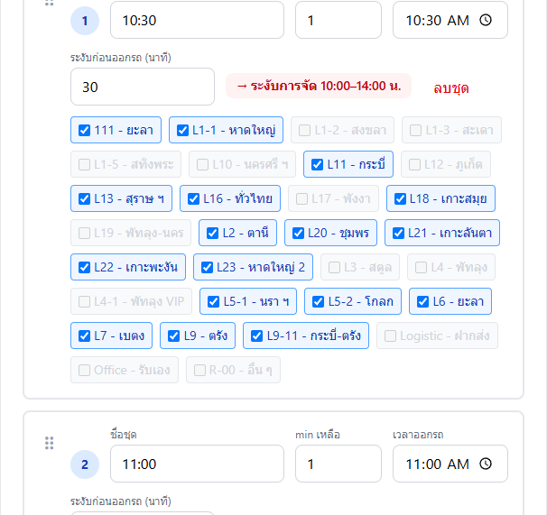

> 1 เส้นทางอยู่ได้แค่ 1 ชุด — ติ๊กในชุดใหม่ ระบบจะเอาออกจากชุดเดิมให้เอง

### 3.5 ระงับอัตโนมัติตามเวลา / ยอดค้าง (พับไว้)

กดหัวข้อ **"▸ ตั้งเวลาระงับรายวัน (จ.–อา.) · ยอดเหลือจัด / รอ QC"** เพื่อกางออก

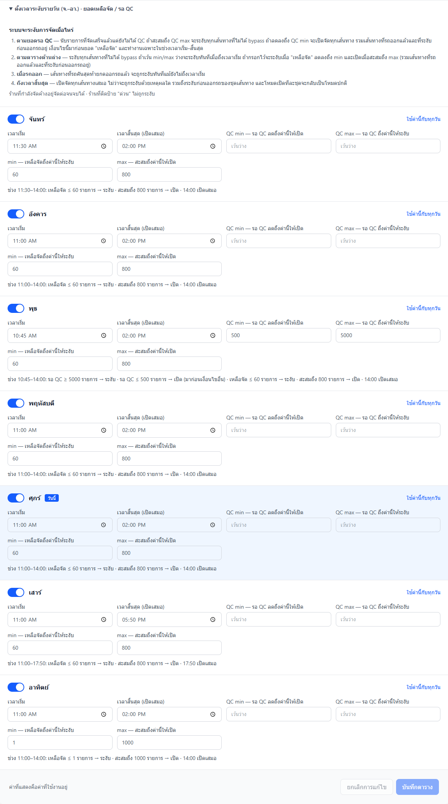

กล่อง **"สถานะตอนนี้"** ด้านบนบอกว่าตอนนี้ระงับอยู่ไหมและจะเปิดเมื่อไหร่

แต่ละวันตั้งได้:
- สวิตช์เปิดใช้วันนั้น · **เวลาเริ่ม** · **เวลาสิ้นสุด** (ถึงเวลานี้ เปิดจัดทุกเส้นทางเสมอ)
- **min / max ยอดเหลือจัด** — เหลือจัดลดถึง min → ระงับทุกเส้นทาง, สะสมถึง max → เปิด (เว้นว่างทั้งคู่ = ระงับทันทีที่ถึงเวลาเริ่ม)
- **QC min / max** — รอ QC ถึง max → ระงับ, ลดถึง min → เปิด (มาก่อนเงื่อนไขเหลือจัด)
- ใต้แต่ละวันมีประโยคสรุปให้อ่านว่าวันนั้นจะระงับยังไง · กด **ใช้ค่านี้กับทุกวัน** เพื่อคัดลอก
- กด **บันทึกตาราง**

ส่วน **"▸ เส้นทาง Bypass"** — เส้นทางที่เลือกไว้จะ **ไม่ถูกระงับอัตโนมัติไม่ว่ากรณีใด** กดชื่อเส้นทางเพื่อเลือก/ยกเลิก มีผลทันที

### 3.6 ตารางรายชั้น — ลังขั้นต่ำ + คนจัดระหว่างระงับ

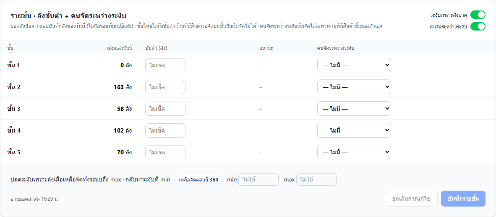

1 แถว = 1 ชั้น:

| คอลัมน์ | ความหมาย |
|---|---|
| **เติมแล้ววันนี้** | ยอดลังที่หน้างานบันทึกใน **แอปบันทึกลัง** ของวันนี้ (ไม่นับรอบที่หัวหน้ากดปฏิเสธ) · ขึ้นวันใหม่เริ่มนับจาก 0 |
| **ขั้นต่ำ (ลัง)** | ถ้ายอดเติมวันนี้ยังไม่ถึง → ร้านที่มีสินค้ารอจัดบนชั้นนี้ **เริ่มจัดไม่ได้** จนกว่าจะเติมลังครบ · เว้นว่าง = ไม่เช็คชั้นนี้ |
| **สถานะ** | 🔴 ระงับ / 🟢 ผ่าน / – (ไม่ได้ตั้ง) |
| **คนจัดระหว่างระงับ** | พนักงาน 1 คนของชั้นนี้ที่ **ยังเริ่มจัดได้แม้ถูกระงับ** (ส่วนที่ 5) |

**สวิตช์มุมขวาบน:**
- **ระงับเพราะลังขาด** — ปิด = ไม่เช็คลังเลย (ตั้งขั้นต่ำไว้ก็ไม่ระงับ)
- **คนจัดระหว่างระงับ** — ปิด = ไม่มีใครได้รับยกเว้น

**ปลดระงับเมื่อยอดค้างเยอะ** (บรรทัดล่าง) — ถ้ายอด **เหลือจัดทั้งระบบ** สะสมถึง **max** ระบบจะปลดการระงับเพราะลังทุกชั้นชั่วคราว (ไม่ให้งานค้างล้น) และกลับมาระงับเมื่อลดลงถึง **min** · เว้นว่างทั้งคู่ = ไม่ใช้ · มีตัวเลข "เหลือจัดตอนนี้" ให้เทียบ

**ขั้นตอน:** ใส่ขั้นต่ำ / เลือกคนจัด / ใส่ min-max → กด **บันทึกรายชั้น**

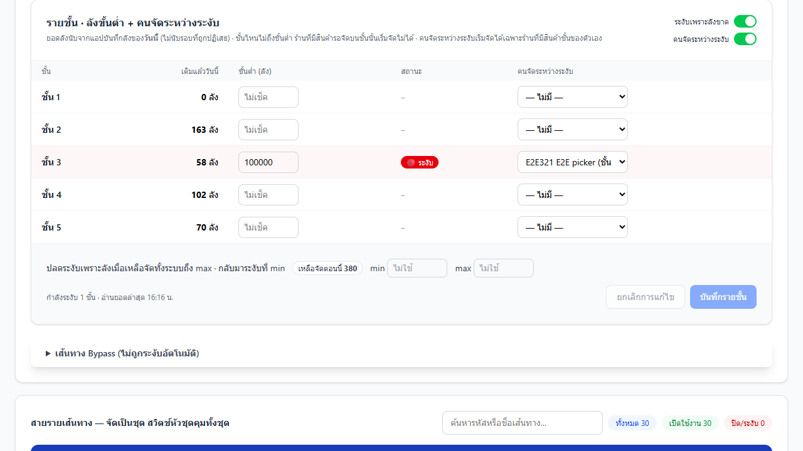

> ⚠️ ถ้าระบบอ่านยอดจากแอปบันทึกลังไม่ได้ จะขึ้นกล่องเหลือง "อ่านยอดจากแอปบันทึกลังไม่ได้" — ระหว่างนั้น **ระบบจะไม่ระงับเพราะลัง** (เพื่อไม่ให้คลังหยุดงานเพราะระบบอื่นมีปัญหา) แจ้งทีม IT
> ถ้ายอดค้างถึง max จะขึ้นกล่องฟ้า "ปลดการระงับเพราะลังชั่วคราว"

### 3.7 สายรายเส้นทาง

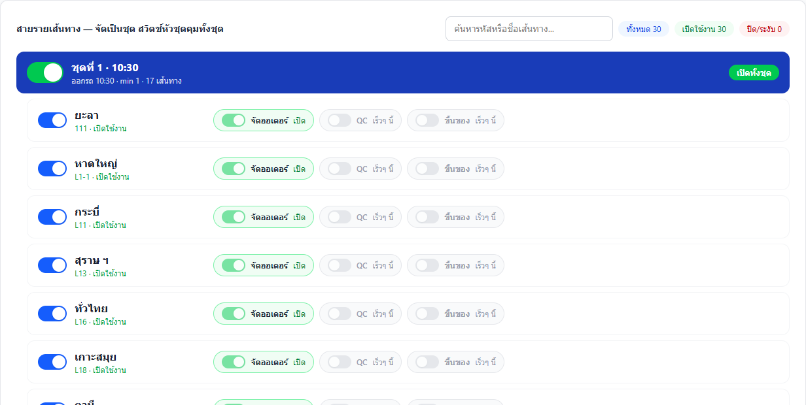

- **แถบหัวชุด** (น้ำเงิน = เปิด, เทา = ปิด) — สวิตช์ใหญ่ซ้ายมือเปิด/ปิด **ทุกเส้นทางในชุด** พร้อมกัน · ป้ายขวามือบอกสถานะ: เปิดทั้งชุด / เปิดบางเส้นทาง / ปิดทั้งชุด (โหมดเปิดทีละชุด: เปิดชุดอยู่ / ชุดถูกปิด)
- **แถวเส้นทาง** — สวิตช์สีน้ำเงินเปิด/ปิดการจัดออเดอร์ของเส้นทางนั้น
- **ชิปสถานีย่อย** จัดออเดอร์ / QC / ขึ้นของ — แสดงสถานะ (QC และขึ้นของรายเส้นทางยังเป็น "เร็วๆ นี้")
- แถบส้ม **"ยังไม่จัดกลุ่ม"** — เส้นทางที่ไม่อยู่ในชุดไหน (โหมดเปิดทีละชุด = ถูกระงับ)
- ช่อง **ค้นหา** รหัส/ชื่อเส้นทาง และตัวนับ ทั้งหมด / เปิดใช้งาน / ปิด-ระงับ

> ⚠️ ถ้ากดสวิตช์หัวชุดหรือสวิตช์เส้นทาง **ตอนอยู่โหมดเปิดทีละชุด** ระบบจะ **ออกจากโหมดเปิดทีละชุดกลับเป็นโหมดปกติ** — จะมีหน้าต่างเตือนให้ยืนยันก่อนทุกครั้ง

---

## 4. สำหรับพนักงานจัดออเดอร์ — เห็นอะไรเมื่อถูกระงับ

ที่หน้า **จัดออเดอร์** (ไม่ต้องรีเฟรช หน้าจออัปเดตเอง):

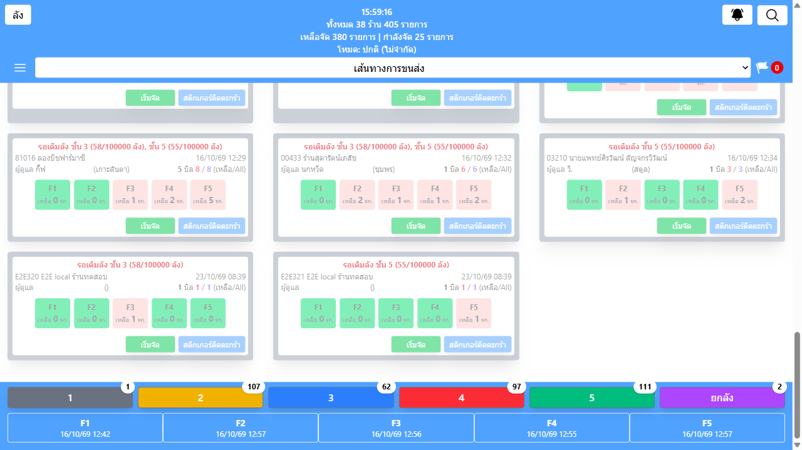

- **แถบแดงด้านบน** "ลังยังเติมไม่ถึงขั้นต่ำ: ชั้น 3 (58/100 ลัง) …" — บอกชั้นที่ต้องเติมลังและยอดตอนนี้
- **การ์ดร้านที่ติด** จะจางลง ย้ายไปท้ายรายการ และมีป้ายแดง เช่น
  - "รอเติมลัง ชั้น 3 (58/100 ลัง)" — ติดเพราะลัง
  - "เส้นทางนี้ถูกระงับ" — ติดเพราะเวลา/ยอดค้าง/รถออก
- กดการ์ดที่ติด → ขึ้นหน้าต่างบอกเหตุผล เริ่มจัดไม่ได้

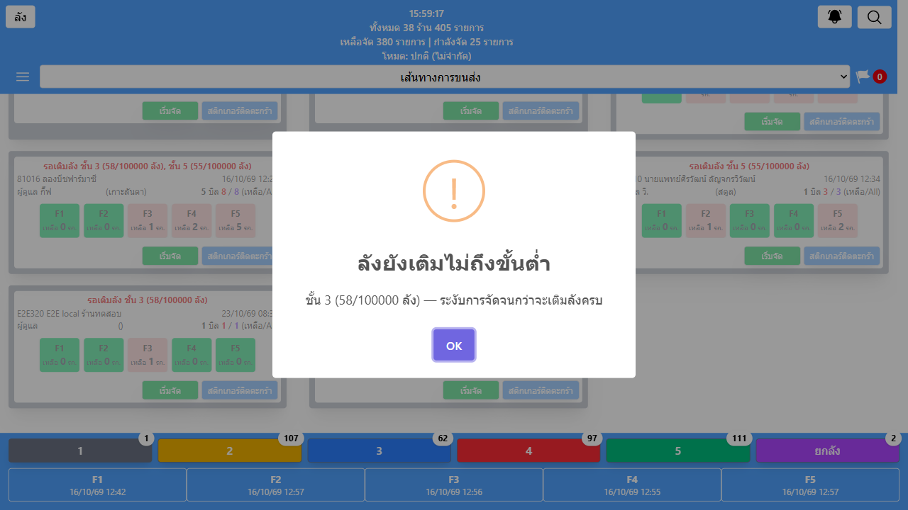

**ทำอย่างไรต่อ:** เติมลังที่ชั้นนั้นแล้ว **บันทึกในแอปบันทึกลัง** — ระบบอ่านยอดทุก 1 นาที ครบขั้นต่ำเมื่อไหร่ร้านจะกลับมาจัดได้เอง

**ไม่ถูกระงับเสมอ:** ร้านด่วน · ร้านที่กำลังจัดค้างอยู่ (จัดต่อจนจบได้) · เส้นทาง Bypass

---

## 5. สำหรับคนจัดระหว่างระงับ

ถ้าแอดมินตั้งคุณเป็น **คนจัดระหว่างระงับ** ของชั้นใด:

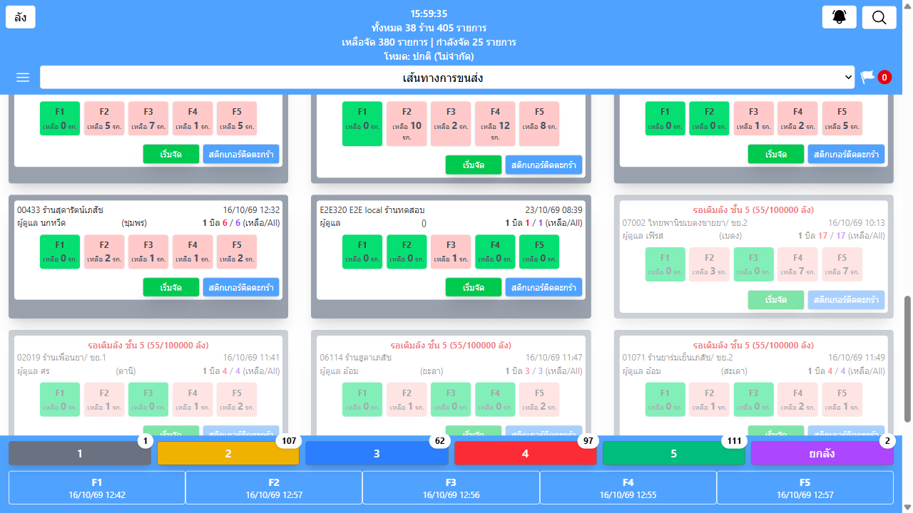

- ร้านที่ **มีสินค้ารอจัดบนชั้นของคุณ** จะ **ไม่จาง ไม่มีป้ายระงับ** และกดเริ่มจัดได้ตามปกติ — แม้ร้านนั้นจะติดระงับเพราะลัง เวลา ยอดค้าง หรือรถออก
- ร้านที่ไม่มีสินค้าชั้นของคุณ ยังติดระงับเหมือนคนอื่น
- เริ่มจัดแล้วจัดทั้งร้าน (ทุกชั้น) ตามปกติ

---

## 6. คำถามที่พบบ่อย

**ไม่เห็นเมนู "แผงควบคุมสายการไหล"**
ต้องเป็นแอดมิน (สิทธิ์ "จัดการสินค้า") และ IT ต้องเปิดฟีเจอร์ `picking-control-page` ก่อน ระหว่างนี้ใช้หน้า "จัดการOrder" เดิมได้

**เข้าหน้าแล้วขึ้น "ยังไม่เปิดใช้งานแผงควบคุมสายการไหล"**
ฟีเจอร์ `picking-control-page` ยังปิดอยู่ แจ้ง IT

**ตารางรายชั้นขึ้น "-" ในช่องเติมแล้ววันนี้**
ระบบยังอ่านยอดจากแอปบันทึกลังไม่ได้ (หรือสวิตช์ "ระงับเพราะลังขาด" ปิดอยู่) — ช่วงนี้ไม่มีการระงับเพราะลัง

**เติมลังแล้วแต่ร้านยังติด**
1) ตรวจว่าบันทึกในแอปบันทึกลังแล้ว และหัวหน้าไม่ได้กด "ปฏิเสธ" รอบนั้น 2) รอไม่เกิน 1 นาที 3) ยอดต้อง **ถึง** ขั้นต่ำ (ไม่ใช่แค่ใกล้)

**ทุกเช้าทำไมชั้นที่ตั้งขั้นต่ำถึงระงับ**
ยอดลังนับเฉพาะวันนี้ ขึ้นวันใหม่เริ่มจาก 0 — เป็นการบังคับให้เติมลังก่อนเริ่มจัด ถ้าไม่ต้องการ ให้เว้นขั้นต่ำว่างหรือปิดสวิตช์ "ระงับเพราะลังขาด"

**กดสวิตช์เส้นทางแล้วโหมดเปิดทีละชุดหายไป**
เป็นเรื่องปกติ — สั่งเปิด/ปิดเส้นทางด้วยมือจะออกจากโหมดเปิดทีละชุด ถ้าต้องการกลับ เลือก "เปิดทีละชุด" ที่โซนขึ้นของอีกครั้ง

**แก้ชุดเส้นทางไม่ได้ ไม่มีปุ่ม "แก้ไขชุด"**
กำลังอยู่โหมดเปิดทีละชุด ต้องสลับเป็นโหมดปกติก่อน

---

## 7. สิ่งที่ยังทำไม่ได้

| ส่วน | สถานะ |
|---|---|
| สวิตช์สถานี **ขึ้นของ** และ **จัดส่ง** | แสดงเป็น "เร็วๆ นี้" — ข้อมูลอยู่ในระบบขนส่ง (logistics) |
| สวิตช์ **QC / ขึ้นของ รายเส้นทาง** | แสดงเป็น "เร็วๆ นี้" — ตอนนี้สวิตช์เส้นทางคุมเฉพาะการจัดออเดอร์ |
| ตัวเลข "ลังที่ปิดบิลแล้วค้างรอขึ้นรถ" | ยังไม่มี |

ติดตามความคืบหน้าได้ที่ Jira **OPHMBC-322**
