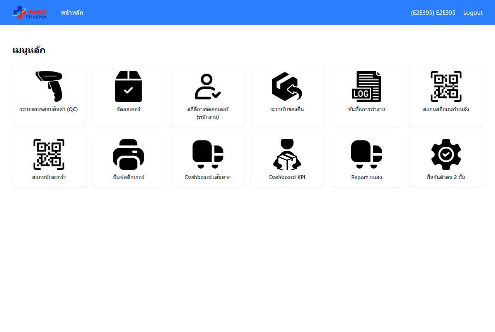
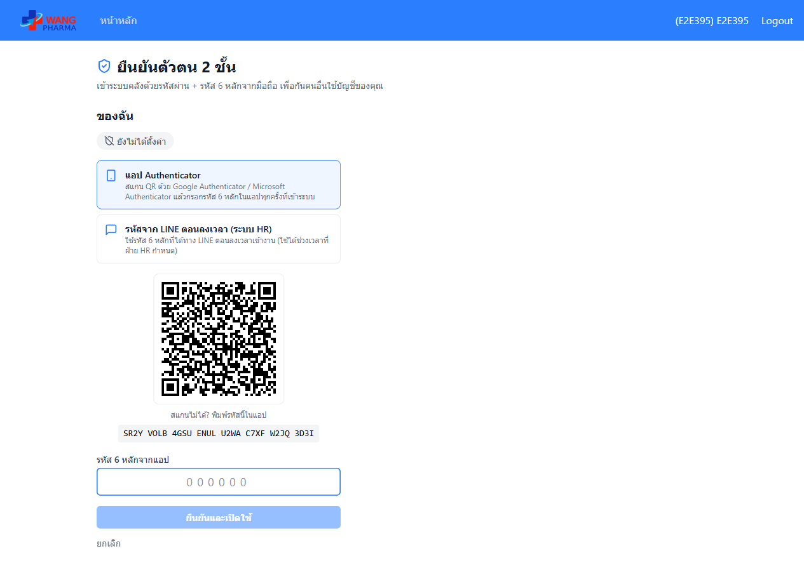
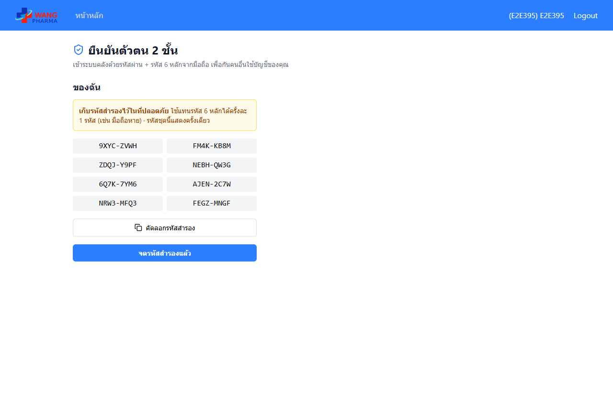
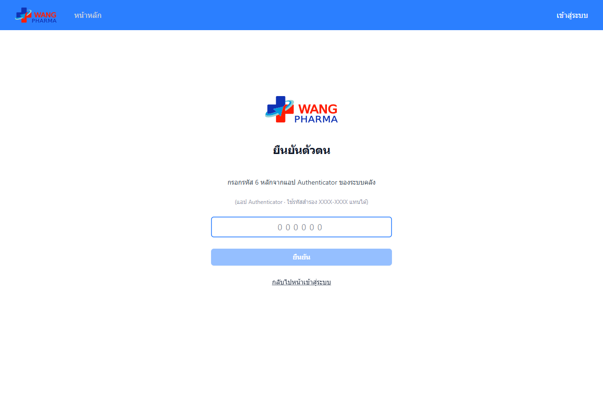
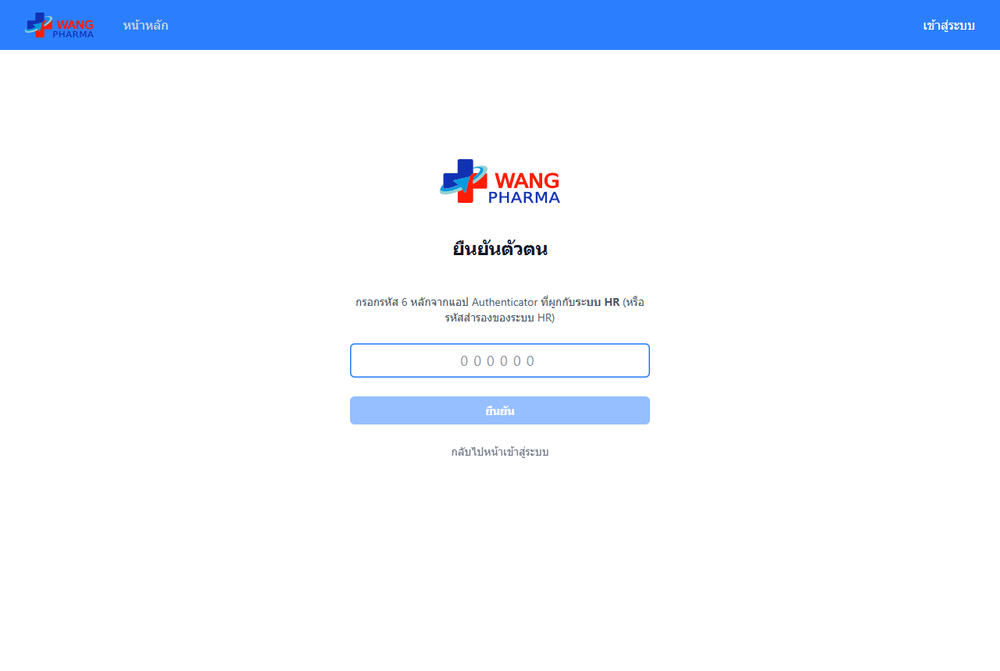
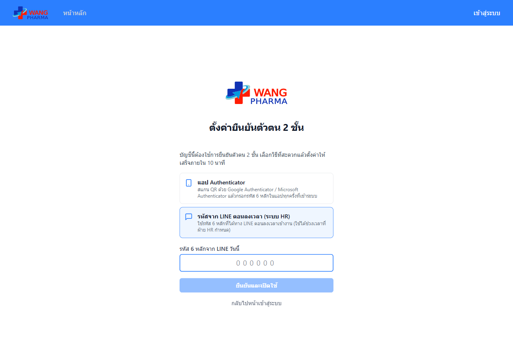
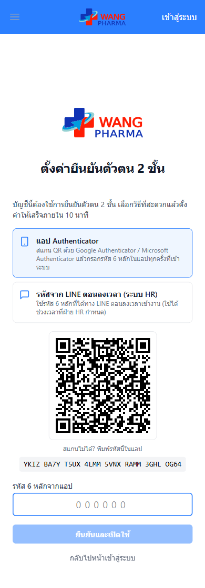
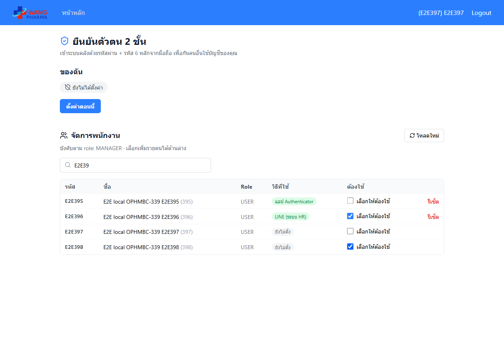
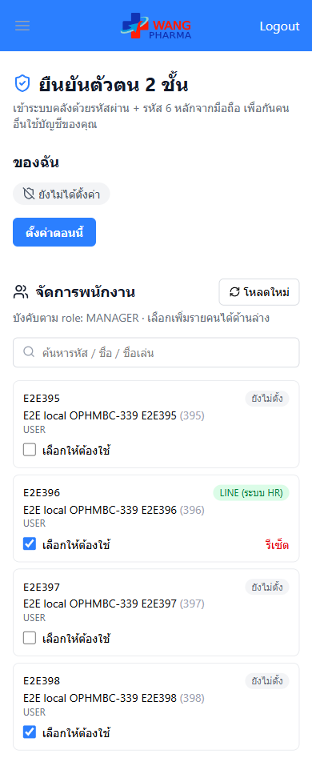

# คู่มือ: ยืนยันตัวตน 2 ชั้น (OPHMBC-339)

เข้าระบบคลังด้วย **รหัสผ่าน + รหัส 6 หลักจากมือถือ** เพื่อกันคนอื่นใช้บัญชีของเรา

> เมนูนี้จะเห็นเมื่อผู้ดูแลระบบเปิดใช้แล้วเท่านั้น (ฝั่งระบบ: `TWO_FACTOR_ENABLED=on` ที่ auth)
> ถ้าไม่เห็นเมนู "ยืนยันตัวตน 2 ชั้น" ในหน้าหลัก แปลว่ายังไม่เปิดใช้

มีให้เลือก 2 วิธี

| วิธี | ใช้อะไร | เหมาะกับ |
|-----|--------|---------|
| **แอป Authenticator** | แอป Google Authenticator หรือ Microsoft Authenticator บนมือถือ | ทุกคน ใช้ได้แม้ไม่มีเน็ต |
| **รหัสจาก LINE ตอนลงเวลา (ระบบ HR)** | รหัส 6 หลักที่ระบบ HR ส่งเข้า LINE ทุกครั้งที่ลงเวลาเข้างาน | คนที่ลงเวลาผ่าน LINE ทุกวันอยู่แล้ว |

ทั้งสองวิธีจะได้ **รหัสสำรอง 8 ชุด** (เช่น `ABCD-EFGH`) ไว้ใช้แทนตอนมือถือหาย — ใช้ได้ชุดละครั้ง

---

## พนักงานทั่วไป

### ตั้งค่าเอง

1. หน้าหลัก → กดเมนู **ยืนยันตัวตน 2 ชั้น**

   

2. กด **ตั้งค่าตอนนี้** แล้วเลือกวิธี
   - **แอป Authenticator** → เปิดแอปในมือถือ กด "+" แล้วสแกน QR (สแกนไม่ได้ให้พิมพ์รหัสตัวอักษรใต้ QR แทน)
   - **รหัสจาก LINE** → เปิด LINE ดูรหัส 6 หลักที่ได้ตอนลงเวลาวันนี้

   

3. กรอกรหัส 6 หลัก → กด **ยืนยันและเปิดใช้**
4. ระบบแสดง **รหัสสำรอง 8 ชุด** ครั้งเดียว — กด **คัดลอกรหัสสำรอง** หรือจดเก็บไว้ แล้วกด **จดรหัสสำรองแล้ว**

   

### เข้าสู่ระบบหลังเปิดใช้

1. กรอกชื่อผู้ใช้ + รหัสผ่านตามปกติ
2. ระบบถามรหัส 6 หลัก → กรอกจากแอป หรือจาก LINE (แล้วแต่วิธีที่เลือก) → **ยืนยัน**

   

- มือถือไม่อยู่กับตัว → พิมพ์ **รหัสสำรอง** แทนได้ในช่องเดียวกัน
- ถ้าตั้งรหัส 6 หลักไว้ที่ **ระบบ HR** ด้วย ระบบจะถามรหัสของระบบ HR ก่อน (ขั้น "ระบบ HR") แล้วค่อยถามรหัสของระบบคลัง

   

### บัญชีที่ถูกบังคับใช้

ถ้าหัวหน้าเลือกให้บัญชีเราต้องใช้ 2 ชั้น ตอนเข้าสู่ระบบครั้งถัดไปจะขึ้นหน้า **ตั้งค่ายืนยันตัวตน 2 ชั้น** ทันที
ทำตามขั้นตอนด้านบนให้เสร็จ **ภายใน 10 นาที** แล้วระบบพาเข้าใช้งานเลย (เกินเวลา → เข้าสู่ระบบใหม่)

 

### ข้อควรระวัง

- กรอกรหัสผิด **5 ครั้งติด** → ล็อค 15 นาที (ติดต่อหัวหน้าให้รีเซ็ตได้)
- รหัสสำรองชุดเดิมจะใช้ไม่ได้ทันทีเมื่อกด **ออกรหัสสำรองใหม่**
- บัญชีที่ถูกบังคับ **ปิดเองไม่ได้** แต่เปลี่ยนวิธีได้ (ต้องกรอกรหัสของวิธีเดิมก่อน)
- วิธี "รหัสจาก LINE" ต้องลงเวลาเข้างานผ่าน LINE ก่อนถึงจะได้รหัส

---

## หัวหน้า / ผู้ดูแล (สิทธิ์ manage_qc)

หน้าเดียวกัน (เมนู **ยืนยันตัวตน 2 ชั้น**) จะมีส่วน **จัดการพนักงาน** เพิ่มด้านล่าง

- **เลือกให้ต้องใช้** — ติ๊กที่ชื่อพนักงาน → คนนั้นต้องตั้งค่า 2 ชั้นตอนเข้าสู่ระบบครั้งถัดไป
  - "(บังคับตาม role)" = role นั้นถูกบังคับจากการตั้งค่าระบบอยู่แล้ว ไม่ต้องติ๊ก
- **รีเซ็ต** — ใช้เมื่อพนักงานมือถือหาย / ถูกล็อค → ล้างการตั้งค่าของคนนั้น
  ถ้ายังถูกบังคับ เข้าสู่ระบบครั้งหน้าจะต้องตั้งค่าใหม่
- ค้นหาด้วยรหัส / ชื่อ / ชื่อเล่น · บนมือถือแสดงเป็นการ์ด

> ⚠️ ระบบอื่นที่ใช้บัญชีเดียวกัน (เช่น ระบบจัดซื้อ แอปขนส่ง) **ยังไม่มีช่องกรอกรหัส 2 ชั้น**
> คนที่เปิด 2 ชั้นแล้วจะเข้าระบบเหล่านั้นด้วยรหัสผ่านอย่างเดียวไม่ได้ — ค่อยๆ เลือกคนบังคับ เริ่มจากคนที่ใช้แค่ระบบคลัง
